# Business Insights Report - Flipkart Product Analytics
_Auto-generated by the notebook from `flipkart_converted.csv`. Re-run the notebook to refresh._

## 1. Objective
Analyse Flipkart product listings (pricing, discounts, ratings, reviews, sellers) to support pricing, inventory and seller-quality decisions.

## 2. Data & method
Raw data (15,575 rows) -> Pandas cleaning (sub-category median imputation, duplicate removal, invalid-value fixes, derived columns) -> MySQL (3 tables) -> 20 SQL queries -> Streamlit + Seaborn charts.
Raw-data quality audit: {'retail_price <= 0': 0, 'discount_price < 0': 0, 'rating outside 0-5': 0, 'negative num_reviews': 0, 'duplicate rows': 0}.
Cleaned dataset: 15,575 listings.

## 3. Key findings
1. Catalogue size: 15,575 listings, 33 categories, 3355 brands, 3485 sellers.
2. 'Clothing' is the biggest category (4,127 listings, 26%); 'Automation & Robotics' is the smallest (1).
3. Deepest discounts: 'Sunglasses' averages 61.4% off vs 0.0% in 'Household Supplies'. Overall average discount is 38.7%.
4. 64% of listings are discounted by more than 30%.
5. Best-rated category: 'Jewellery' (4.78); lowest: 'Home Improvement' (2.23). 82% of products are rated Excellent (>=4.0).
6. Most listings (excluding Unknown brand): Allure Auto (469). Seller = brand in this dataset, and many sellers have only 1-3 listings, so seller rankings are indicative only.
7. Seller offering the deepest average discount: 'Rajcrafts' (96.5%).
8. Stock health: not available in this dataset (stock_status is Unknown for every listing).
9. Rating vs review-count correlation cannot be computed because the dataset has no review counts.
10. Average retail price is Rs.3,368 but the median is Rs.1,050 -> a few premium items pull the mean up.

### Category summary
| category | listings | avg_retail | avg_discount_pct | avg_rating |
|---|---|---|---|---|
| Clothing | 4127 | 1408.71 | 42.92 | 4.08 |
| Jewellery | 2934 | 8987.89 | 39.34 | 4.78 |
| Automotive | 991 | 2940.85 | 54.83 | 3.99 |
| Footwear | 989 | 1782.38 | 35.54 | 3.9 |
| Home Decor & Festive Needs | 768 | 2455.28 | 34.95 | 4.37 |
| Beauty and Personal Care | 690 | 856.36 | 19.4 | 3.71 |
| Kitchen & Dining | 641 | 917.78 | 43.75 | 4.64 |
| Computers | 572 | 3250.67 | 43.11 | 3.83 |
| Watches | 530 | 2870.1 | 20.09 | 4.03 |
| Mobiles & Accessories | 495 | 1529.14 | 50.68 | 4.46 |
| Home Furnishing | 483 | 2089.35 | 36.83 | 4.23 |
| Tools & Hardware | 335 | 1360.99 | 28.9 | 3.05 |
| Toys & School Supplies | 316 | 1318.73 | 27.67 | 4.06 |
| Baby Care | 285 | 1526.59 | 31.28 | 4.54 |
| Other | 259 | 1792.05 | 37.81 | 4.48 |
| Pens & Stationery | 241 | 1327.63 | 30.09 | 4.25 |
| Bags, Wallets & Belts | 227 | 2154.9 | 46.32 | 3.48 |
| Furniture | 164 | 22593.84 | 29.82 | 2.59 |
| Sports & Fitness | 163 | 1859.87 | 24.82 | 4.51 |
| Cameras & Accessories | 82 | 1518.89 | 17.07 | 3.75 |
| Home Improvement | 81 | 1454.77 | 20.74 | 2.23 |
| Health & Personal Care Appliances | 43 | 3803.93 | 33.83 | 3.84 |
| Gaming | 34 | 1481.03 | 49.53 | 4.0 |
| Sunglasses | 28 | 1059.64 | 61.36 | 4.04 |
| Home & Kitchen | 24 | 4387.12 | 32.58 | 4.52 |
| Pet Supplies | 23 | 695.13 | 26.66 | 4.0 |
| Home Entertainment | 19 | 3944.95 | 34.86 | 4.47 |
| eBooks | 15 | 4773.27 | 8.32 | 4.6 |
| Eyewear | 7 | 2209.43 | 49.67 | 4.0 |
| Household Supplies | 4 | 479.25 | 0.0 | 4.0 |
| Food & Nutrition | 2 | 1662.5 | 11.2 | 4.0 |
| Wearable Smart Devices | 2 | 1149.0 | 57.28 | 4.0 |
| Automation & Robotics | 1 | 19999.0 | 15.0 | 4.0 |

### Seller summary
| seller_name | listings | avg_rating | total_reviews | avg_discount_pct |
|---|---|---|---|---|
| Unknown | 4581 | 4.03 | 0 | 33.97 |
| Allure Auto | 469 | 4.0 | 0 | 65.83 |
| Voylla | 266 | 4.93 | 0 | 24.71 |
| Regular | 241 | 3.99 | 0 | 47.34 |
| Karatcraft | 211 | 5.0 | 0 | 28.2 |
| Slim | 195 | 3.99 | 0 | 45.51 |
| Speedwav | 136 | 4.03 | 0 | 47.94 |
| Radiant Bay | 132 | 5.0 | 0 | 20.15 |
| BlueStone | 99 | 4.95 | 0 | 22.34 |
| Black | 96 | 3.93 | 0 | 57.97 |
| White | 80 | 4.01 | 0 | 61.06 |
| AdroitZ | 72 | 4.35 | 0 | 62.22 |
| Easy Gardening | 56 | 2.96 | 0 | 29.13 |
| Regular Fit | 49 | 4.02 | 0 | 52.08 |
| Raymond | 49 | 4.0 | 0 | 2.86 |

_Top 15 sellers by listings (seller = brand)._

### Top 10 discounts
| product_name | brand | retail_price | discount_price | discount_percentage |
|---|---|---|---|---|
| Rajcrafts Floral Double Quilts & Comforters White | Rajcrafts | 6000.0 | 208.0 | 96.53 |
| FashBlush Forever New Orange Bead & Chain Alloy Necklace | Fashblush | 3999.0 | 189.0 | 95.27 |
| FashBlush Forever Beautiful White Bead Alloy Necklace | Fashblush | 3499.0 | 189.0 | 94.6 |
| Bling Book Case for iPad 2 / 3 | Bling | 1816.0 | 99.0 | 94.55 |
| FashBlush Forever New BlackBead & LongChain Alloy Necklace | Fashblush | 4999.0 | 279.0 | 94.42 |
| Fashblush Alloy Choker | Fashblush | 4499.0 | 289.0 | 93.58 |
| Fash Blush Forever New Gold & White Pearl Chunk Alloy Necklace | Fash Blush | 2999.0 | 199.0 | 93.36 |
| FashBlush Forever New BlackBead Alloy Necklace | Fashblush | 2999.0 | 199.0 | 93.36 |
| Mydress Mystyle Bulb Led USB Led Light | Mydress Mystyle | 999.0 | 75.0 | 92.49 |
| Fash Blush Forever New Red & Gold Tribal Thread Alloy Necklace | Fash Blush | 2499.0 | 198.0 | 92.08 |

## 4. Recommendations
* **Pricing:** 'Sunglasses' discounts the most (61.4% avg) while 'Jewellery' is rated best - check whether deep discounts actually buy better ratings or volume, and protect margin where they do not.
* **Inventory:** stock data is not in this dataset; add stock status before planning replenishment.
* **Seller quality:** about 91% of ratings are imputed, so rating-based seller rankings are not reliable; use real review data before featuring sellers.
* **Marketing:** promote Excellent-rated products in low-discount categories - quality sells without heavy discounting.
* **Catalogue quality:** missing/invalid prices and ratings had to be imputed - fix them at the source.

## 5. Charts
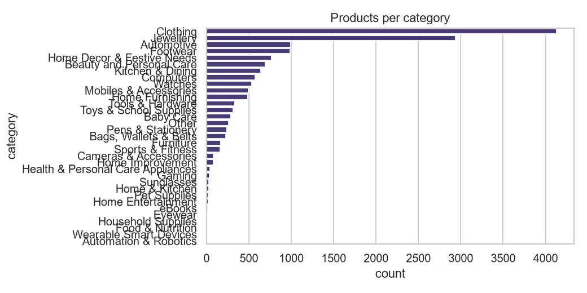
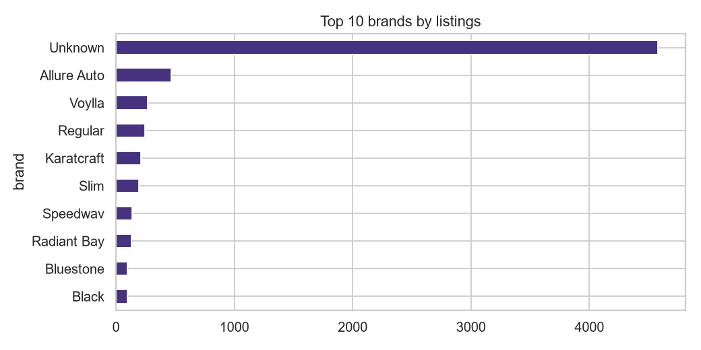
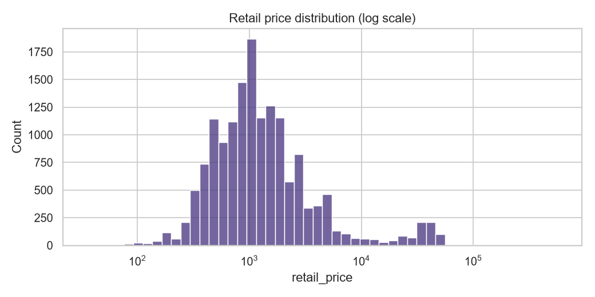
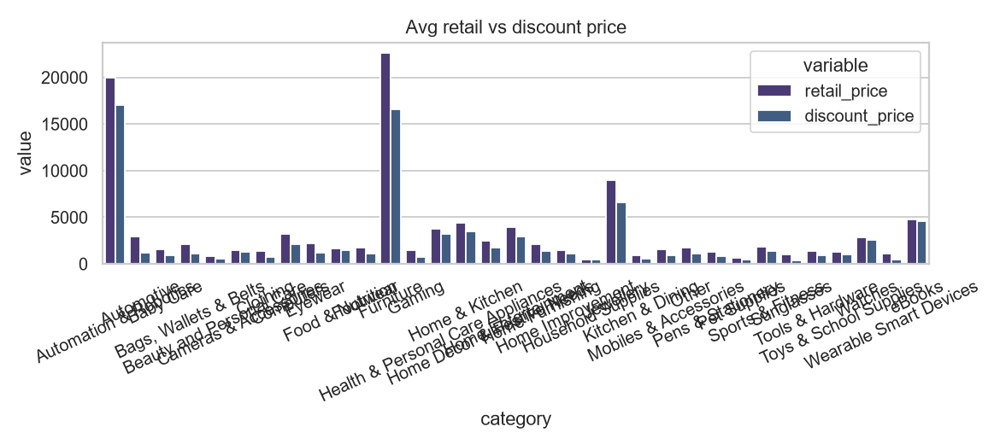
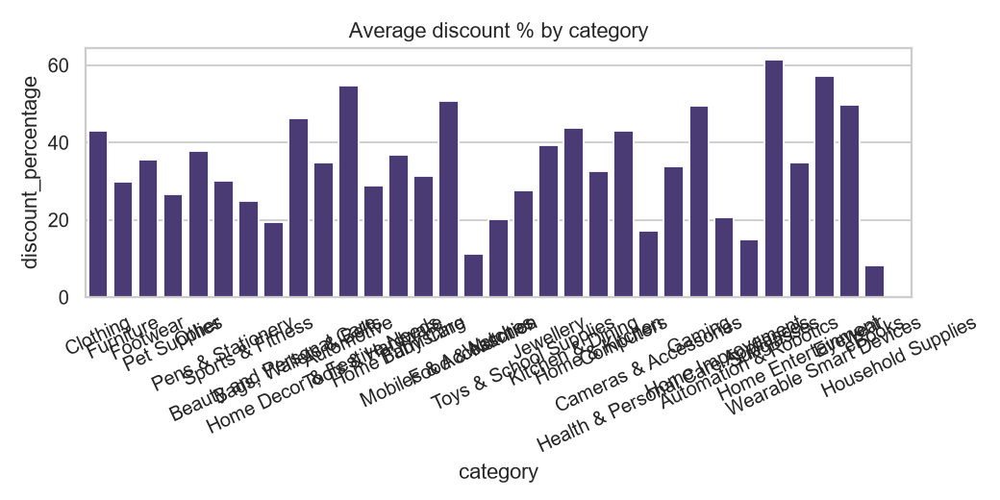
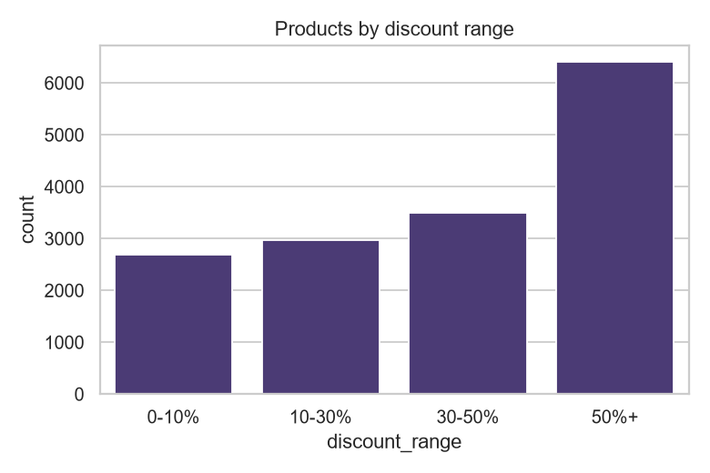
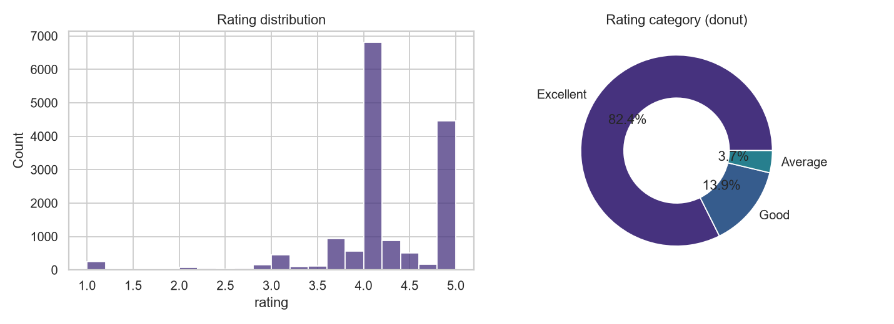
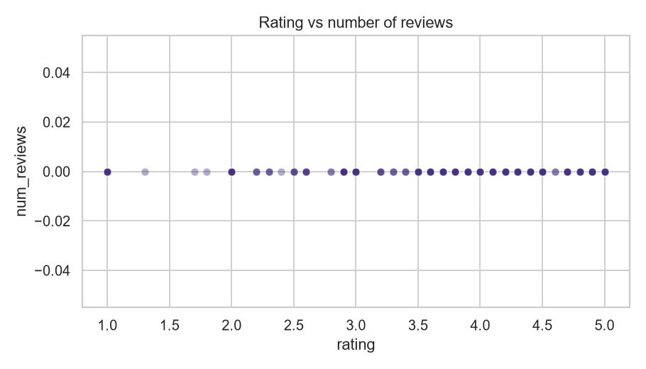
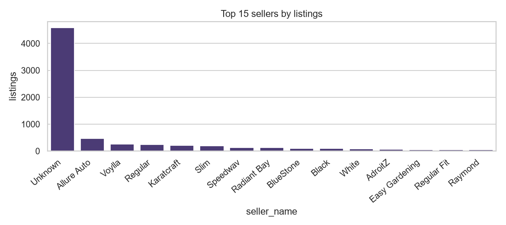
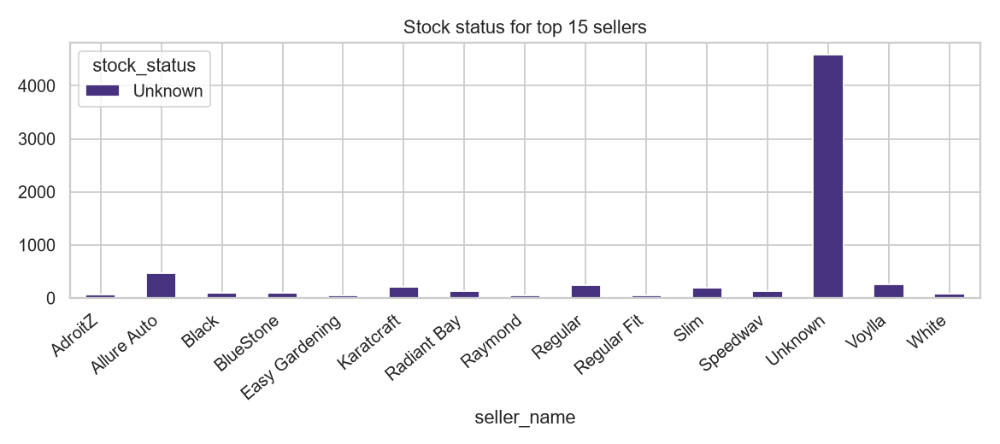
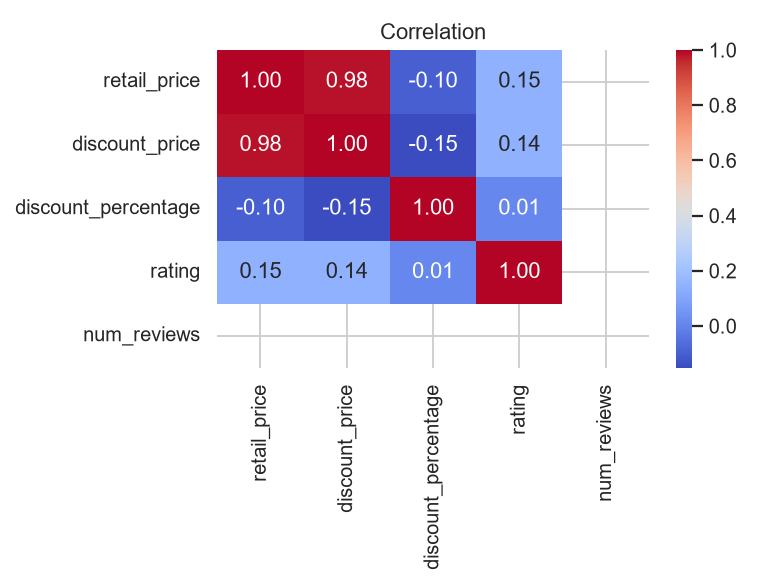
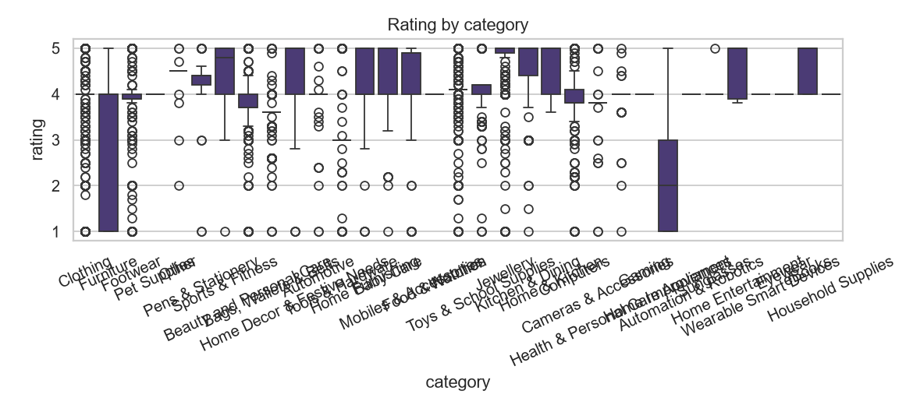

## 6. Limitations
Imputed values (sub-category median) are estimates; ratings are product-level; the data is a snapshot, not a time series.

## 7. Dataset limitations (important)
- **Source:** Kaggle "Flipkart Products" sample (flipkart_com-ecommerce_sample.csv), 20,000 raw rows. After removing duplicates (same name and prices) 15,575 listings remain.
- **Seller:** the file has no seller column, so `seller_name` is set to the brand. Listings with no brand (about 5,800 before cleaning) are labelled "Unknown" and excluded from seller rankings.
- **Reviews and stock:** the file has no review counts or stock status. `num_reviews` is empty and `stock_status` is "Unknown", so review and stock charts carry no information.
- **Ratings:** only about 9% of listings had a real numeric rating. The rest were filled with the sub-category median, as the brief asks, so rating results are mostly estimates.
- **Categories:** some rows had no category path, so they are grouped under "Other".
- **Brand quality:** the brand column contains some non-brand values (for example "Regular", "Slim", "Black"), so brand and seller rankings are approximate.
