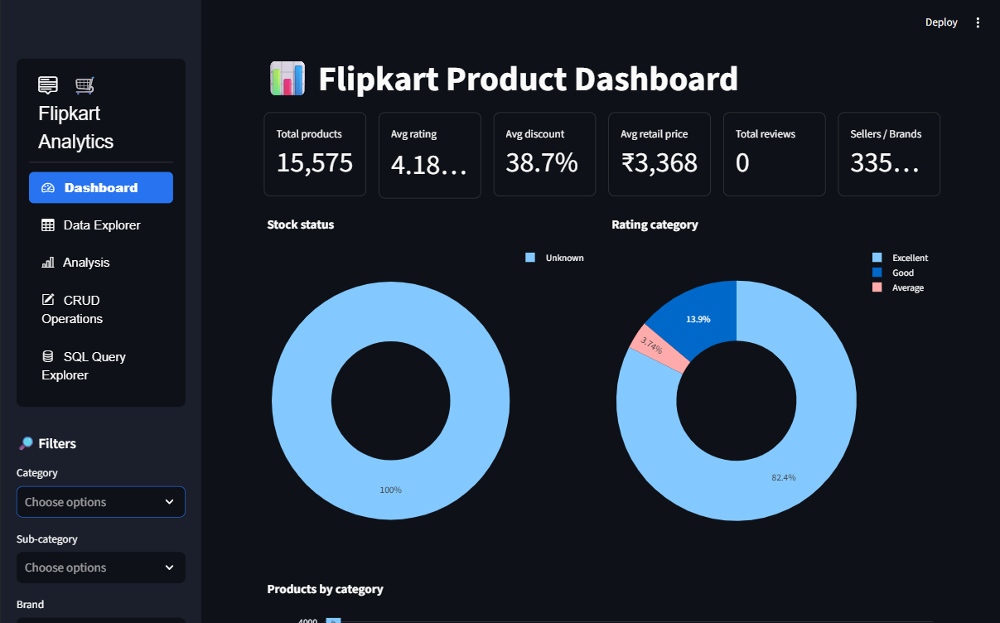
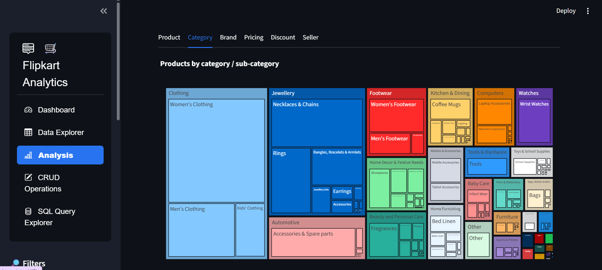
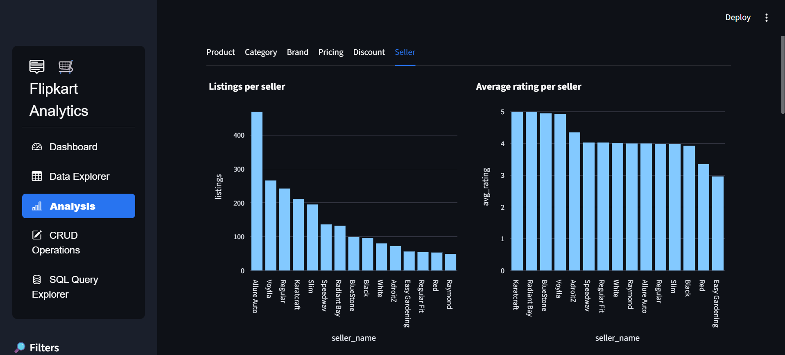
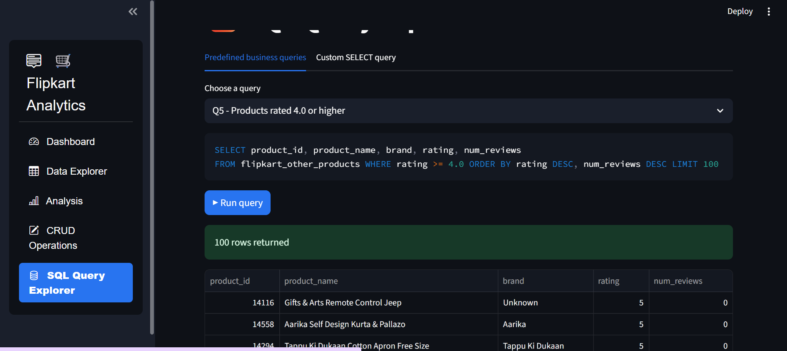

# 🛒 Flipkart Product Analytics & Business Intelligence Dashboard

End-to-end analytics pipeline: **raw CSV → Pandas cleaning → MySQL → SQL analysis → Streamlit dashboard → Power BI**.

## Project structure
```
flipkart_project/
├── app.py                         # Streamlit dashboard (5 pages)
├── requirements.txt
├── notebooks/flipkart_analysis.ipynb   # cleaning, feature engineering, EDA, MySQL load
├── sql/
│   ├── 01_create_tables.sql       # database + 3 tables + indexes
│   ├── 02_standardize_columns.sql # review_count -> num_reviews, views
│   └── 03_business_queries.sql    # 20 business queries
├── data/
│   ├── other_products_raw.csv     # raw input  (REPLACE with the real dataset)
│   ├── other_products_cleaned.csv # output of the notebook
│   └── make_sample_data.py        # generates a demo dataset if you have none
├── charts/                        # Seaborn charts saved by the notebook
├── POWERBI_GUIDE.md               # step-by-step Power BI build (DAX + visuals)
└── BUSINESS_INSIGHTS_REPORT.md    # insights report - AUTO-GENERATED by the notebook (last cell)
```

## 1. Prerequisites (only 2 installs)
* **Python 3.10+** (python.org - tick "Add Python to PATH"). Jupyter and all libraries come from `pip install -r requirements.txt`.
* **MySQL 8** running on `localhost:3306` (the MySQL installer, or XAMPP and press *Start* next to MySQL).
* Optional: Power BI Desktop (Windows) - see `POWERBI_GUIDE.md`. Not required: the Seaborn charts in `charts/` and the Streamlit dashboards cover the visualization phase.
* Optional: Git. Without it, upload the folder on github.com via *Add file -> Upload files*.

## 2. Setup
```bash
python -m venv .venv
.venv\Scripts\activate            # Windows   (Mac/Linux: source .venv/bin/activate)
pip install -r requirements.txt
```

## 3. Database configuration
The notebook and `app.py` read these environment variables (defaults in brackets):

| variable | default |
|---|---|
| `FLIPKART_DB_USER` | `root` |
| `FLIPKART_DB_PASSWORD` | `your_password` ← **change** |
| `FLIPKART_DB_HOST` | `localhost` |
| `FLIPKART_DB_PORT` | `3306` |
| `FLIPKART_DB_NAME` | `flipkart_db` |

Set the password once (or just edit the `DB = dict(...)` block at the top of the notebook and `app.py`):
```bash
set FLIPKART_DB_PASSWORD=yourpassword          # Windows cmd
$env:FLIPKART_DB_PASSWORD="yourpassword"       # PowerShell
export FLIPKART_DB_PASSWORD=yourpassword       # Mac/Linux
```

## 4. Run the pipeline
1. Put the real dataset at `data/other_products_raw.csv` (**CSV or JSON** both work; for JSON change `RAW_CSV` in the notebook,
   or set `FLIPKART_RAW=path/to/file.json`). Flipkart `product_category_tree` columns are split into category / sub-category automatically.  
   (no dataset? run `python data/make_sample_data.py` to create a demo file)
2. `jupyter notebook` → open `notebooks/flipkart_analysis.ipynb` → **Run All**  
   This cleans the data, saves `data/other_products_cleaned.csv`, creates the database/tables, loads them, saves the charts and
   **writes `BUSINESS_INSIGHTS_REPORT.md`** with your real numbers.  
   (Headless alternative: `jupyter nbconvert --to notebook --execute notebooks/flipkart_analysis.ipynb`)
3. Optional: run the SQL files in MySQL Workbench — `sql/03_business_queries.sql` has the 20 queries.
4. Launch the dashboard:
```bash
streamlit run app.py
```

> The notebook maps common column names automatically (`seller→seller_name`, `review_count→num_reviews`,
> `discounted_price→discount_price`, `subcategory→sub_category` ...). If your file uses other names, add them to the `ALIASES` dictionary in the notebook.

## 5. Streamlit pages
| page | what it does |
|---|---|
| Dashboard | KPI cards, products by category, stock-status & rating donuts, live insights |
| Data Explorer | search + filter, view and download filtered data as CSV |
| Analysis | tabs for Product, Category, Brand, Pricing, Discount, Seller analysis |
| CRUD Operations | create / read / update / delete products (kept in sync across the 3 tables) |
| SQL Query Explorer | run the 20 predefined queries or your own read-only SELECT |

Global sidebar filters: category, sub-category, brand, seller, stock status, rating, price and discount range.

## 6. Database design
| table | purpose |
|---|---|
| `flipkart_other_products` | main product table (PK `product_id`) |
| `category_catalog` | price / rating catalogue with product URL |
| `seller_performance` | seller-wise product rating, reviews and stock status |
| view `flipkart_products` | alias of the main table |
| view `seller_summary` | seller avg rating + total reviews |

Derived columns: `discount_amount`, `discount_percentage`, `price_difference` (= discount_price − retail_price),
`rating_category` (Excellent ≥ 4, Good 3–3.99, Average < 3) and `discount_range` (0-10%, 10-30%, 30-50%, 50%+).

## 7. Power BI
See `POWERBI_GUIDE.md`.

## 8. Push to GitHub
```bash
git init
git add .
git commit -m "Flipkart product analytics project"
git branch -M main
git remote add origin https://github.com/<your-username>/flipkart-product-analytics.git
git push -u origin main
```
Repository: `https://github.com/<your-username>/flipkart-product-analytics`

> ⚠️ The CSVs, charts and report currently in this folder were generated from a **demo sample dataset**. Re-run the notebook on your real data to overwrite them before submitting.

## Dataset note
This project uses the Kaggle "Flipkart Products" sample (20,000 raw rows, 15,575 after de-duplication). The file has no seller, review-count or stock columns, so seller_name = brand, and review and stock fields are empty or "Unknown". See BUSINESS_INSIGHTS_REPORT.md, section 7.

## Screenshots





## Re-running with the real data
The raw Kaggle file (flipkart_com-ecommerce_sample.csv, 38 MB) is not included because of its size. Download it from Kaggle "Flipkart Products", put it in `data/`, and run `python data/convert_flipkart.py`. Then set the environment variable `FLIPKART_RAW` to the path of `data/flipkart_converted.csv` before starting Jupyter. `data/other_products_raw.csv` is a small generated demo file.

## GitHub repository
https://github.com/tesindhueswar/flipkart-product-analytics
